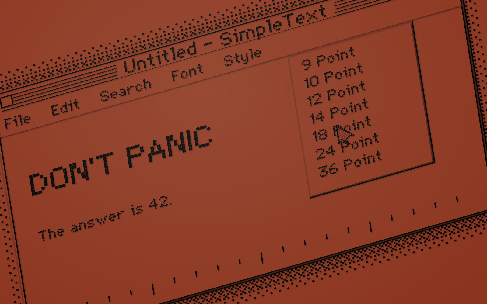
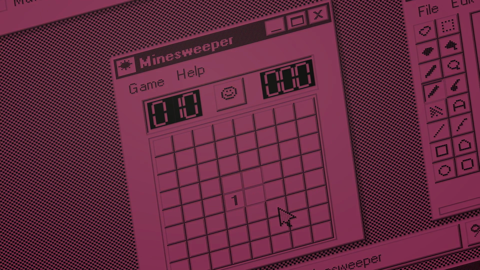

# Retro Duet Saver

**让 Macintosh 与 Windows 95/98 的经典界面，在像素画布里缓慢游走。**

运行于 Windows 11 的复古动态屏保：黑色像素、立体边缘、渐变配色，以及自动鼠标交互。灵感来自 macOS Sequoia 的 Macintosh 屏保。




## 场景与动效

- **40 个 Mac / Windows 场景**：时钟、控制面板、编辑器、画图、计算器、错误窗口、扫雷、字符映射表、MS-DOS 和 Clippy。
- **随机播放**：首次显示时钟，系统随机；之后各场景等概率出现，相邻不重复。
- **分场景镜头**：控制面板近景巡览、音量纵向移动、键盘横向掠过、画图缓慢拉远；倾角固定，平移与推拉平滑衔接。
- **像素转场**：像素随空间位置逐渐缩小、消散，再从纯色背景中浮现。
- **自动交互**：鼠标移动、点击、滑块拖动、窗口拖拽、绘图与逐字输入；错误窗口关闭后回原位重新弹出。
- **经典控制面板**：原生像素绘制早期 Macintosh 的键盘、鼠标、菜单闪烁、插入点闪烁、桌面图案和双击速度控件。
- **启动演出**：问号软盘切换至 Happy Mac，图标轮廓与背景衔接。
- **科幻彩蛋**：DON'T PANIC、DO NOT ANSWER、七百五十万年计算与 42；两套计算器输入 1984。
- **签名演出**：By RylanTu / Passion for a better world。

完整目录见 [场景一览](docs/SCENES.md)。

## 下载与运行

前往 [Releases](https://github.com/RylanTu/retro-duet-saver/releases) 下载 ZIP，解压后运行 **RetroDuetSaver.exe** 或 **Preview.cmd**。

| 入口 | 功能 |
| --- | --- |
| Preview.cmd | 完整随机播放 |
| Screensaver.cmd | 多屏屏保，移动鼠标或按键退出 |
| Settings.cmd | 配色、速度、帧率与灯带设置 |
| Control-Panel-Preview.cmd | Mac 控制面板预览 |
| Review-Quick.cmd | 快速浏览全部场景 |
| Review-Normal.cmd | 按正常时长浏览全部场景 |

右键 **RetroDuetSaver.scr** → **安装**，即可在 Windows 屏幕保护程序设置中选择本项目。[安装与使用](docs/USAGE.md)

**快捷键**：F11 / Enter 全屏，Esc 退出，S 设置，空格切换配色，A 开关自动鼠标，P 暂停，F2 显示帧率。检查模式支持 PgDn / PgUp 切换场景、Home 重播。

## 多屏与渲染

- 多屏共享场景、随机调度与动画状态，同步播放并按屏幕比例裁切。
- 显示器配置变化后自动重建屏保窗口。
- 支持 60 / 120 / 144 FPS 目标上限。
- 静态材质缓存复用、可见区域裁剪，时钟和交互内容按需更新。
- 转场结束后卸下像素缩放着色器及采样表面。

## Govee 灯带联动

在设备中启用 **LAN Control**，再在屏保设置中开启灯带联动：

- 自动发现局域网设备并开灯；无设备时暂停取色，每 30 秒短暂扫描一次。
- 灯光随画面颜色平滑渐变，饱和度可调。
- 屏保运行满半小时关闭灯带。
- 半小时内退出，恢复至 5400 K、100% 亮度。

另提供独立的 [开关机灯光服务](tools/govee-boot/README.md)：开机发现设备并设为 5400 K、100% 亮度，正常关机关闭；开机等待局域网连接就绪后仅扫描一轮，未发现设备不重试。[灯带配置](docs/GOVEE-LAN.md)

## 从源码构建

使用 Windows x64 自带的 .NET Framework 4.x、WPF 与 C# 编译器。

```powershell
powershell -NoProfile -ExecutionPolicy Bypass -File .\build.ps1
```

构建结果输出至 `dist/`，包含 EXE、SCR、启动脚本和便携 ZIP。

```text
src/                 C# / WPF 场景、交互与渲染
shaders/             像素缩放着色器及编译字节码
scripts/             预览、设置与屏保启动器
examples/            计算场景 BASIC 示例
tools/              着色器构建与灯光服务
docs/               使用、开发与场景资料
```

[开发说明](docs/DEVELOPMENT.md) · [渲染设计](docs/ARCHITECTURE.md) · [字体与素材来源](THIRD_PARTY_NOTICES.md) · [MIT License](LICENSE)

By **RylanTu** · Passion for a better world
